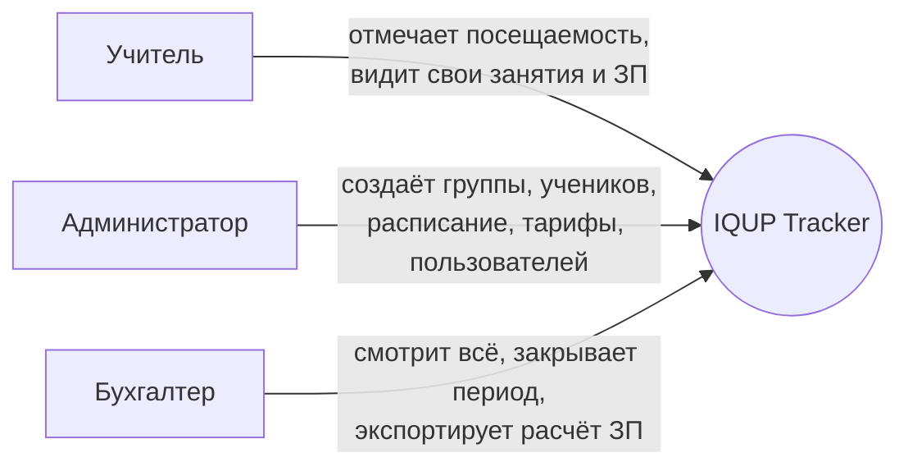
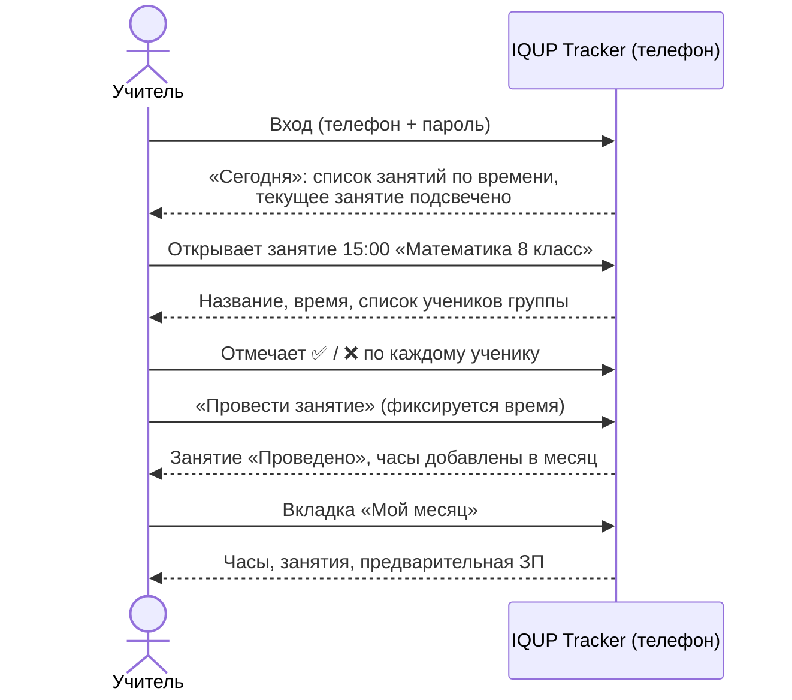

# IQUP Tracker — видение системы

> Учебный центр **IQ UP** (Бишкек, 3 мкр, 6 дом) — математика, подготовка к ОРТ, химия, продлёнка (1–8 класс).
> Владелица — Каныкей. Instagram: [@iqupkg](https://www.instagram.com/iqupkg/).

## 1. Проблема

Каждый день зарплаты учителя спорят с владелицей о расчёте. Причина — нет единого источника правды о том, **какие занятия реально прошли, сколько они длились и кто на них был**. Всё считается вручную задним числом, по памяти и переписке.

## 2. Цель системы (одно предложение)

**Фиксировать факт и время каждого проведённого занятия в момент его проведения, чтобы зарплата учителя считалась автоматически и бесспорно, а оплаты учеников были прозрачны.**

Критерий успеха: в день зарплаты владелица открывает отчёт по учителю за месяц, учитель открывает тот же отчёт у себя — цифры совпадают, и обсуждать нечего.

## 3. Принципы

| Принцип | Что это значит на практике |
|---|---|
| **Факт фиксируется в момент события** | Учитель отмечает посещаемость во время занятия, а не вечером и не в конце месяца. Система записывает время отметки. |
| **Ничего не удаляется, всё журналируется** | Любое изменение занятия/посещаемости/оплаты задним числом — отдельная запись с автором, временем и причиной. Спор решается просмотром истории. |
| **Закрытый период не меняется** | Бухгалтер «закрывает» месяц. После этого прошлые занятия и расчёт ЗП заморожены; корректировки — только отдельной строкой в следующем периоде. |
| **Учитель видит свою ЗП сам** | Прозрачность работает в обе стороны: учитель в любой момент видит отработанные часы и предварительную сумму. |
| **Правила — в настройках, не в коде** | Тарифы, ставки учителей, число допустимых пропусков — редактирует администратор без программиста. |
| **Бесплатно в эксплуатации** | Бесплатный хостинг, бесплатная БД, поддомен без покупки домена. Система для личного пользования одного центра. |

## 4. Роли

| Роль | Видит | Делает | Не может |
|---|---|---|---|
| **Учитель** | Свои группы, своё расписание, своих учеников, свои часы и предварительную ЗП | Отмечать посещаемость, подтверждать проведение занятия, фиксировать фактическое время, оставлять комментарий к занятию | Видеть чужие группы, менять тарифы, править оплаты, менять прошлое после закрытия периода |
| **Администратор** | Всё | Всё, что учитель + CRUD групп, учеников, расписания, тарифов, ставок, пользователей и их ролей; правки задним числом (с причиной); фиксация оплат | — |
| **Бухгалтер** | Всё | Фиксировать оплаты учеников, закрывать/открывать расчётный период, экспортировать отчёты по ЗП и оплатам | Создавать/редактировать пользователей, группы, учеников, тарифы, посещаемость |

> Вопрос к Каныкей: кто физически принимает деньги от родителей — админ или бухгалтер? От этого зависит, кому дать право «записать оплату». Пока даю обоим.

## 5. Пользовательские сценарии

### 5.1 Учитель — рабочий день

Детали поведения:
- По умолчанию открывается **сегодня**. Если текущее время попадает в окно занятия (± допуск, например 15 минут до и 30 после), занятие показывается первым и крупно — одна кнопка «Открыть».
- Посещаемость можно отмечать с момента начала занятия и до конца дня. После этого — только админ, с причиной.
- Если учитель не отметил занятие вовсе, на следующий день оно висит как **«Не подтверждено»** и у учителя, и у админа. В ЗП не попадает, пока не подтверждено.
- Замена учителя: админ назначает на конкретное занятие другого учителя — часы уходят заменяющему.

### 5.2 Администратор — запуск группы

1. Создаёт группу: название, предмет, класс, тип (групповая / мини / парная / индивидуальная / продлёнка), учитель, расписание (дни недели + время + длительность), дата старта.
2. Система генерирует занятия на N недель вперёд (например, до конца учебного года), пропуская праздники из календаря.
3. Добавляет учеников в группу (зачисление) — с датой начала. Ученик, пришедший в середине курса, видит занятия только с даты зачисления.
4. Назначает тариф группе и ставку учителю.

### 5.3 Бухгалтер — день зарплаты

1. Открывает «Расчёт ЗП» за месяц → таблица по учителям: проведено занятий, часов, ставка, сумма, корректировки.
2. По каждой строке можно провалиться до списка занятий с посещаемостью и временем подтверждения.
3. Нажимает «Закрыть период» — расчёт замораживается, экспорт в Excel/PDF.
4. Отдельный экран «Оплаты учеников»: кто сколько внёс, сколько занятий «сгорело», у кого долг.

## 6. Что система НЕ делает (пока)

- Не принимает платежи онлайн, не интегрируется с банками.
- Не ведёт журнал оценок и домашних заданий.
- Не отправляет SMS/уведомления родителям (может позже — Telegram-бот).
- Не считает налоги и не формирует официальные бухгалтерские документы.

## 7. Связанные документы

- [01 — Доменная модель и бизнес-правила](01-domain-model.md)
- [02 — Архитектура](02-architecture.md)
- [03 — План проекта](03-project-plan.md)
- [04 — Вопросы для Каныкей](04-questions-for-kanykei.md)
