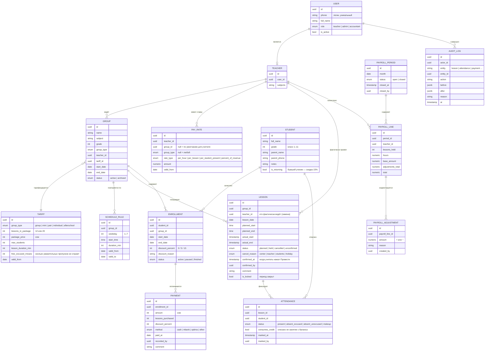
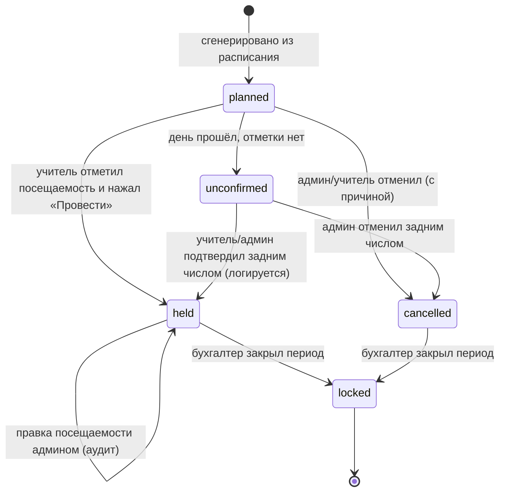
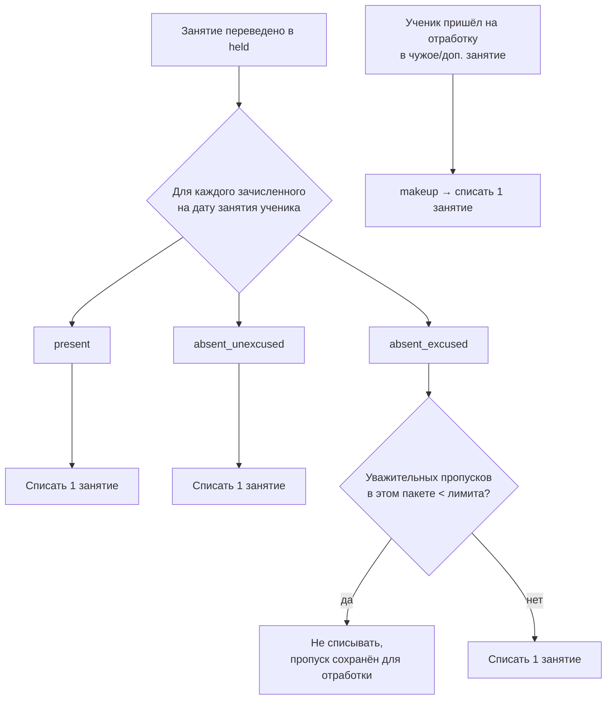

# IQUP Tracker — доменная модель и бизнес-правила

Документ описывает сущности, их связи и правила, по которым система считает занятия, баланс учеников и зарплату учителей. Всё, что помечено **❓**, — гипотеза, которую нужно подтвердить у Каныкей (см. [04-questions-for-kanykei.md](04-questions-for-kanykei.md)).

## 1. Словарь (ubiquitous language)

| Термин | Значение |
|---|---|
| **Группа** | Постоянный состав учеников с одним учителем, предметом и расписанием. Напр. «Математика, 8 класс, ПН/СР/ПТ 14:00». Индивидуальное занятие — тоже группа из одного ученика. |
| **Тип группы** | Групповая (5–10), мини-группа (до 4), парная (2), индивидуальная (1), продлёнка (до 8). Определяет тариф и лимит мест. |
| **Расписание** | Правило повторения: дни недели + время начала + длительность. Из него генерируются занятия. |
| **Занятие** | Конкретное событие в календаре: группа, дата, плановое время. Имеет статус (запланировано → проведено / отменено). Единица, за которую платят учителю и которую «тратит» ученик. |
| **Посещаемость** | Отметка «ученик X на занятии Y»: присутствовал / отсутствовал (уважительно / неуважительно) / отработка. |
| **Зачисление** | Факт «ученик состоит в группе с даты A по дату B». Ученик может быть зачислен в несколько групп. |
| **Тариф** | Цена пакета: N занятий за M сом для типа группы. Напр. групповая — 12 занятий за 3200 сом. |
| **Абонемент / баланс** | Сколько оплаченных занятий осталось у ученика в данной группе. Пополняется оплатой, тратится проведёнными занятиями. |
| **Ставка** | Правило оплаты учителя: за час / за занятие / за ученика / % от оплат. Задаётся на учителя (и может переопределяться для группы). |
| **Расчётный период** | Месяц. Пока открыт — цифры предварительные. После закрытия бухгалтером — заморожен. |
| **Корректировка** | Ручная строка в расчёте ЗП (премия, штраф, аванс, исправление) с обязательной причиной. |

## 2. Сущности и связи



## 3. Тарифы (из Instagram, сентябрь 2026)

| Тип | Учеников | Пакет | Цена | За 1 занятие |
|---|---|---|---|---|
| Групповая | 5–10 | 12 занятий | 3 200 сом | ≈ 267 сом |
| Мини-группа | до 4 | 12 занятий | 3 800 сом | ≈ 317 сом |
| Парная | 2 | 12 занятий | 4 400 сом | ≈ 367 сом |
| Индивидуальная | 1 | 12 занятий | 7 200 сом | 600 сом |
| Продлёнка | до 8 | 20 занятий × 3 ч (пн–пт) | 7 400 сом | 370 сом (≈ 123 сом/час) |

Акции:
- **15 %** на первый месяц для бывших учеников (`student.is_returning`).
- **5 %** «приведи друга» — ❓ кому: тому, кто привёл, или обоим? На один месяц или постоянно?

❓ Длительность одного занятия по математике/химии неизвестна (60? 80? 90 минут?). От неё зависит и расчёт «часов» учителя.

## 4. Жизненный цикл занятия



Правила:
1. Учитель может перевести занятие в `held` **в день занятия** (с начала занятия и до 23:59). Раньше — нельзя (защита от «отметил всё на неделю вперёд»).
2. `confirmed_at` — системное время нажатия, не редактируется никем. Это главный аргумент в споре.
3. `actual_start` / `actual_end` — **не фиксируем в MVP** (предварительно подтверждено 07.10: учителю достаточно отметить занятие в течение дня по памяти). Факт проведения + `confirmed_at` — достаточно. Поля остаются в схеме на будущее.
4. Отменённое занятие по вине центра/праздник — ❓ оплачивается ли учителю? По умолчанию нет.
5. Занятие, на которое никто не пришёл, но учитель был — ❓ оплачивается? По умолчанию да (учитель отработал время), ученикам не списывается (уважительных пропусков ноль, неуважительные — списываются).

## 5. Посещаемость и баланс ученика



- **Баланс** ученика в группе = Σ `lessons_purchased` − Σ `attendance.consumes_credit`.
- Баланс < 0 → **долг** (центр разрешает ходить «в кредит» — ❓ разрешает ли, и сколько).
- Баланс ≤ 2 → система подсвечивает «пора оплачивать» админу (и учителю, чтобы напомнил родителям — ❓ надо ли учителю это видеть).
- ❓ Абонемент привязан к **количеству занятий** (12) или к **календарному месяцу**? Если к месяцу — непосещённые сгорают в конце месяца, и модель баланса меняется.
- ❓ Сколько уважительных пропусков «бесплатно» (`free_excused_misses`)? Что считается уважительной причиной и кто решает (учитель при отметке / админ)?
- ❓ Ученик, зачисленный в середине пакета группы: покупает полный пакет и «догоняет», или платит пропорционально оставшимся занятиям?

## 6. Расчёт зарплаты учителя

> **Предварительно (07.10, см. [05-decisions.md](05-decisions.md)):** ЗП зависит от **числа учеников на проведённых занятиях**. За каждого учтённого ученика на каждом занятии учитель получает долю от **полной тарифной цены урока** (`package_price / lessons_in_package`); скидки и акции на ЗП не влияют. Период — календарный месяц. Открыто: считаются ли отсутствовавшие ученики и каков размер доли.
>
> Рабочая формула: `ЗП = Σ(занятия held) Σ(учтённые ученики) (package_price / lessons_in_package) × доля%`.
> Пример: групповая, 8 учеников, 12 занятий, доля 40 % → 8 × 12 × 266,67 × 0,4 = 10 240 сом.

Система поддерживает несколько типов ставки; по предварительным ответам основной — `percent_of_revenue` (или `per_student_present`, если доля окажется фиксом в сомах):

| `rate_type` | Формула за занятие | Когда применимо |
|---|---|---|
| `per_hour` | `amount × planned_duration_min / 60` | Классический почасовой учёт — ближе всего к запросу «фиксировать время» |
| `per_lesson` | `amount` | Фикс за занятие, зависит от типа группы |
| `per_student_present` | `amount × count(present + makeup)` | Мотивация на посещаемость |
| `percent_of_revenue` | `package_price / lessons_in_package × count(учтённые ученики) × amount%` | **Основной кандидат.** Доля от полной тарифной цены уроков учеников на занятии. База — тариф, а не фактическая оплата: скидки на ЗП не влияют |

Алгоритм за период:

```
для каждого учителя T в месяце M:
    lessons = занятия со status = held, teacher_id = T, lesson_date ∈ M
    base = Σ по lessons: rate(T, lesson.group).apply(lesson)
    adjustments = Σ PAYROLL_ADJUSTMENT за M
    total = base + adjustments
```

Выбор ставки для занятия — по приоритету: ставка на конкретную группу → ставка на тип группы → ставка учителя по умолчанию. Берётся запись с максимальным `valid_from ≤ lesson_date` (ставки меняются, история сохраняется).

Что увидит учитель в «Мой месяц»: проведено занятий, часов, список занятий с датой/временем подтверждения, предварительная сумма и пометка «предварительно, период открыт» или «закрыт бухгалтером DD.MM».

## 7. Спорные кейсы и предлагаемое поведение по умолчанию

| # | Кейс | Поведение по умолчанию (до ответа Каныкей) |
|---|---|---|
| 1 | Учитель забыл отметить занятие | `unconfirmed`; в ЗП не входит; учитель и админ видят красный бейдж; подтвердить можно до закрытия периода, факт позднего подтверждения виден в отчёте |
| 2 | Учитель отметил занятие, которого не было | Видно `confirmed_at` вне окна занятия → подсветка «подтверждено вне времени»; админ может отменить с причиной |
| 3 | Замена учителя | Админ меняет `lesson.teacher_id` → часы уходят заменяющему, в аудите видно, кто изначально был |
| 4 | Перенос занятия на другой день | Отмена старого (`cancel_reason = center`) + создание нового разового занятия; оба в истории группы |
| 5 | Праздник | Календарь праздников КР; генератор расписания пропускает даты; уже созданные занятия массово отменяются с причиной `holiday` |
| 6 | Ученик пришёл в середине месяца | `enrollment.start_date` = дата первого занятия; посещаемость создаётся только с этой даты; баланс считается от его оплат |
| 7 | Ученик ушёл | `enrollment.end_date`; остаток баланса виден (возврат/перенос — ❓ бывает ли) |
| 8 | Ученик ходит в две группы | Два зачисления, два независимых баланса |
| 9 | Отработка пропуска в другой группе | `attendance.status = makeup` на занятии чужой группы; списывает 1 занятие из баланса **своей** группы |
| 10 | Ошибка в посещаемости обнаружена через неделю | Админ правит, обязателен `reason`; аудит хранит «до/после»; если период закрыт — нельзя, только корректировка ЗП |
| 11 | Скидка 15 % / 5 % | На зачислении: `discount_percent` + причина; оплата хранит фактическую сумму и `lessons_purchased` — баланс в занятиях не зависит от скидки |
| 12 | Продлёнка: ребёнок ушёл раньше / пришёл на 1 час | Для ученика — одно занятие (день); для учителя — 3 часа по плану. ❓ Бывает ли оплата продлёнки «по часам» |
| 13 | Учитель ведёт две группы одновременно (объединил) | Запрещено расписанием (пересечение по времени у одного учителя — предупреждение при создании) |

## 8. Инварианты (то, что система гарантирует всегда)

- У `held`-занятия есть `confirmed_at` и `confirmed_by`.
- `confirmed_at` никогда не меняется.
- Запись в закрытом периоде (`is_locked`) не редактируется никем, включая админа.
- Любое изменение `lesson`, `attendance`, `payment`, `pay_rate`, `enrollment` пишет строку в `AUDIT_LOG`.
- Баланс ученика пересчитывается из первичных данных (оплаты и посещаемость), а не хранится как число — чтобы его нельзя было «подправить».
- Сумма ЗП в закрытом периоде пересчитывается в точности в то же значение (детерминированность: ставки с `valid_from`, никаких «текущих» значений).
