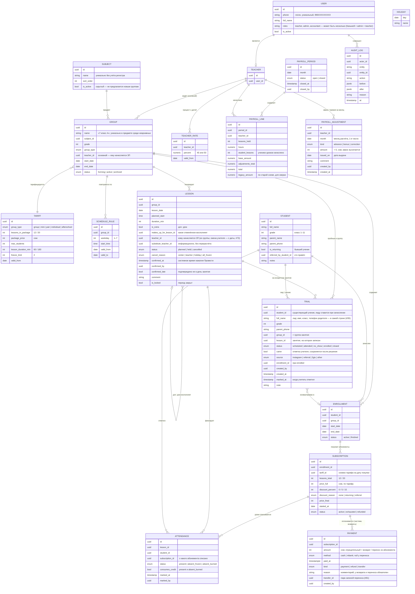
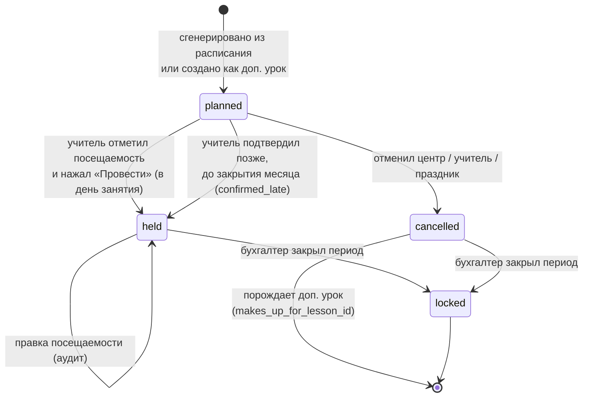
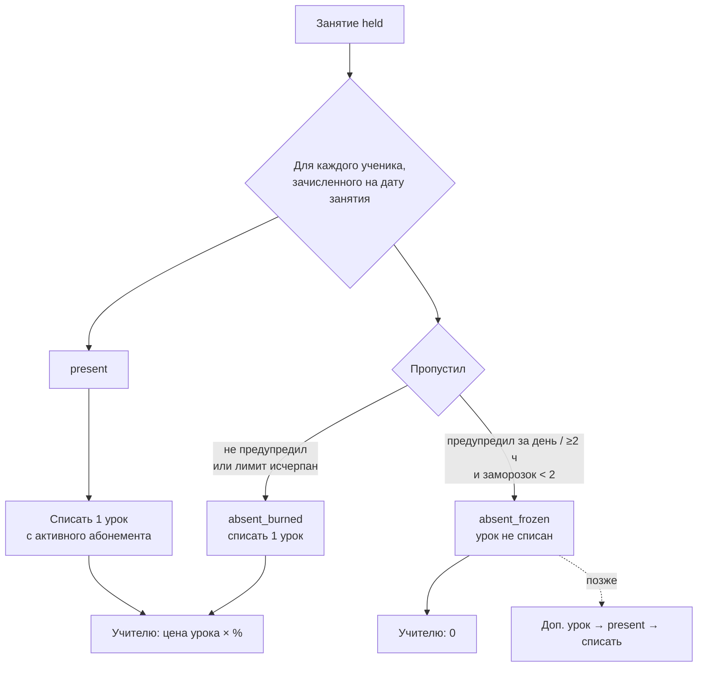
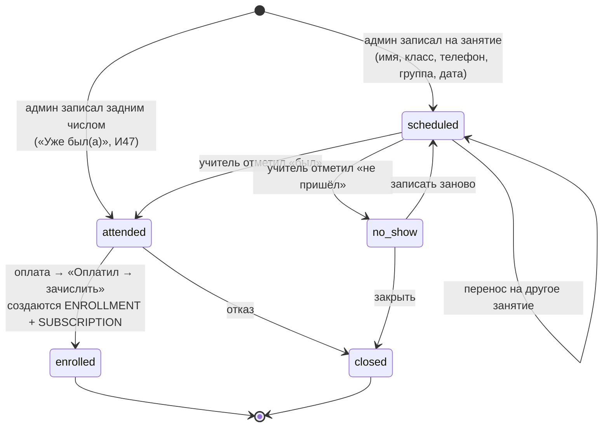

# IQUP Tracker — доменная модель и бизнес-правила

Документ описывает сущности, их связи и правила, по которым система считает занятия, баланс учеников и зарплату учителей. Правила подтверждены анкетой Каныкей (08.10.2026) — см. [05-decisions.md](05-decisions.md). Всё, что помечено **🟡**, — наш дефолт, ожидающий подтверждения.

## 1. Словарь (ubiquitous language)

| Термин | Значение |
|---|---|
| **Группа** | Постоянный состав учеников с одним учителем, предметом и расписанием. Напр. «Математика, 8 класс, ПН/СР/ПТ 14:00». Индивидуальное занятие — тоже группа из одного ученика. |
| **Тип группы** | Групповая (5–10), мини-группа (до 4), парная (2), индивидуальная (1), продлёнка (до 8). Определяет тариф и лимит мест. |
| **Расписание** | Правило повторения: дни недели + время начала. Длительность — 60 мин (продлёнка — 180). Из него генерируются занятия. |
| **Занятие** | Конкретное событие в календаре: группа, дата, плановое время. Статус: запланировано → проведено / отменено. **Доп. занятие** — разовое занятие, восполняющее отменённое или замороженные уроки. |
| **Посещаемость** | Отметка «ученик X на занятии Y»: присутствовал / пропустил с заморозкой / пропустил — урок сгорел. |
| **Зачисление** | Факт «ученик состоит в группе с даты A по дату B». Ученик может быть зачислен в несколько групп. |
| **Тариф** | Цена пакета: 12 занятий (продлёнка — 20) за M сом для типа группы. Меняется раз в год, история хранится. |
| **Абонемент** | Покупка пакета учеником в конкретной группе: 12 уроков по тарифу на дату покупки, со скидкой или без. Оплачивается одним или несколькими платежами. Уроки списываются по мере проведения занятий. |
| **Заморозка** | Пропуск по уважительной причине (ученик предупредил за день или минимум за 2 часа). Урок не списывается. Лимит — 2 на абонемент. Отрабатывается на доп. занятии. |
| **Сгорание** | Пропуск без предупреждения или сверх лимита заморозки. Урок списывается с абонемента, учителю начисляется. |
| **Пробное занятие** | Бесплатный первый визит ещё не зачисленного ученика (или целой набираемой группы) на конкретное занятие. Не списывает уроки, учителю не начисляется, в заполненность группы не входит. Учитель отмечает был / не пришёл; админ после оплаты конвертирует в зачисление. В Excel Каныкей это «красные» ученики. |
| **Процент учителя** | Доля учителя от полной тарифной цены одного урока одного ученика: 45 % (одна учительница — 50 %). |
| **Расчётный период** | Календарный месяц. Выплата 15-го числа следующего месяца. После закрытия бухгалтером — заморожен. |
| **Корректировка** | Аванс (минус), премия (плюс), исправление — ручная строка в расчёте с обязательной причиной. |

## 2. Сущности и связи



## 3. Тарифы и ставки (сентябрь 2026, подтверждено)

| Тип | Учеников | Пакет | Цена | Цена урока | Учителю за ученико-урок (45 %) | (50 %) |
|---|---|---|---|---|---|---|
| Групповая | 5–10 | 12 × 60 мин | 3 200 | 266,67 | 120,00 | 133,33 |
| Мини-группа | до 4 | 12 × 60 мин | 3 800 | 316,67 | 142,50 | 158,33 |
| Парная | 2 | 12 × 60 мин | 4 400 | 366,67 | 165,00 | 183,33 |
| Индивидуальная | 1 | 12 × 60 мин | 7 200 | 600,00 | 270,00 | 300,00 |
| Продлёнка | до 8 | 20 × 3 ч (пн–пт) | 7 400 | 370,00 | 166,50 | 185,00 |

Скидки (только на цену для ученика, на ЗП не влияют): **15 %** бывшим ученикам на первый абонемент; **5 %** тому, кто привёл друга, на один абонемент. Других нет. Тарифы меняются раз в год — храним с `valid_from`, абонемент фиксирует цену на дату покупки.

**Цена урока для ЗП берётся из абонемента, а не из тарифа на дату занятия (К6, #35):** `subscription.price_full / subscription.lessons_total` абонемента, с которого списан урок (`attendance.subscription_id`). Таблица выше — цены абонементов, купленных по тарифу сентября 2026. Смена тарифа не меняет начисления по уже купленным абонементам.

**Новый тариф (А9, К6):** если по типу группы уже есть абонементы, новая версия начинает действовать **не раньше 1-го числа следующего месяца** (по `bishkek_today()`); по типу без абонементов — с сегодняшнего дня. Версия планируется одной датой для всех типов (И8), поэтому в форме минимум — 1-е следующего месяца, как только абонементы есть хотя бы по одному типу; подсказка: «Для действующих групп новый тариф начнёт действовать с 1 ноября. Купленные абонементы остаются по старой цене». БД дублирует проверку по каждому типу (`tariffs_guard`, 0012); сервисная роль (сид, импорт #14) не ограничена.

## 4. Жизненный цикл занятия



Правила:
1. Учитель переводит занятие в `held` **в день занятия** (с начала и до 23:59). Если забыл — может сам подтвердить позже до закрытия периода; такое подтверждение помечается `confirmed_late = true` и видно админу и бухгалтеру.
2. `confirmed_at` — системное время, не редактируется никем.
3. Фактическое время начала/конца **не фиксируется** — споры не про длительность.
4. Отменённое занятие (любая причина) **не оплачивается** и **не списывает уроки**. Оно обязательно восполняется доп. уроком: учитель/админ создаёт `is_extra` занятие со ссылкой на отменённое. Доп. урок — обычное занятие: оплачивается и списывается при проведении.
5. Никто не пришёл, учитель был → занятие проводится как обычно: все отмечаются `absent_burned` (если не предупреждали) → уроки списываются, учителю начисляется. Если **вся группа** предупредила заранее — занятие отменяется с причиной `all_frozen` и **переносится в конец месяца** доп. уроком; личный лимит заморозок учеников не тратится 🟡.
6. Замена: `substitute_teacher_id` только для истории. Начисление — `LESSON.teacher_id`: при создании занятия это `GROUP.teacher_id`; учителя меняются между собой без перерасчёта. Смена учителя группы (И49) переводит на нового учителя занятия **с выбранной даты** (вместе с ЗП за проведённые), прошлые остаются у прежнего.
7. Праздники — свой список центра (`HOLIDAY`); генератор пропускает эти даты.

## 5. Посещаемость, абонемент и баланс ученика



**Абонемент** (`SUBSCRIPTION`) — центральная сущность учёта ученика:
- Создаётся админом при оплате (или при зачислении — в долг). Фиксирует `lessons_total = 12`, `price_full` по тарифу на дату, скидку и `price_final`.
- **Баланс в уроках** = `lessons_total − count(attendance.consumes_credit)` по этому абонементу. Когда 0 → `exhausted`, следующее списание идёт в новый абонемент (создаётся автоматически как неоплаченный — это и есть «в долг»).
- **Баланс в деньгах** = `price_final − Σ payment.amount`. Оплата частями — несколько платежей.
- **Частичная оплата открывает пропорциональное число уроков:** `paid_lessons = floor(Σ payment.amount / (price_final / lessons_total))`. Оплатил 1 600 из 3 200 → доступно 6 уроков; доплатил — открылись остальные.
- **Долг в уроках** = `consumed_lessons − paid_lessons`, если > 0. Допускается до **3 уроков** (подсветка жёлтым админу и учителю; на 4-м — красным, но система не блокирует отметку — решение остаётся за центром). Учителю начисляется за все списанные уроки независимо от оплаты.
- **Заморозка** считается на абонемент: `count(absent_frozen) ≤ tariff.freeze_limit`. Третий «уважительный» пропуск — всё равно `absent_burned`, UI предупреждает учителя.
- **Заморозка заранее (И55, #84):** если ученик предупредил администратора, админ ставит «Заморозку» на запланированное занятие до его начала — `attendance_presets`, не отметка; снять — пока не проведено (И56). Лимит при постановке — мягкая проверка (заморозки абонемента + другие предустановки), жёсткий — `enforce_freeze_limit` при проведении. Учитель видит её предзаполненной («Админ: предупредил»), может поменять; `confirm_lesson` берёт её по умолчанию.
- Замороженные уроки отрабатываются на **доп. занятии** группы: там ученик `present` → списывается тот же абонемент.
- **Перенос долга (И37):** уроки «в долг» сверх абонемента засчитываются в следующий купленный абонемент ученика в группе (только в расчёте `v_student_balance` / `balance.ts`, отметки не переписываются).
- **Возврат** — платёж с отрицательной суммой и причиной; абонемент → `refunded` (И38), зачисление не меняется (И42). Платежи не правятся и не удаляются — только встречная запись (И41). Сумма = остаток оплаченных уроков × `price_final / lessons_total` (система подсказывает, админ может скорректировать).
- **Остаток зачисления (#81, И57):** цена урока = `price_final / lessons_total` абонемента (с учётом скидки), использовано = списанные с него уроки (`consumes_credit`, с переносом долга И37); `остаток = Σ оплат − ceil(использовано × цена урока)` по невозвращённым абонементам, отрицательный = долг (`enrollment_settlement`).
- **Перенос** — пара неизменяемых записей `kind = transfer` с общим `transfer_id`, без `method`: «перенос в <группа>» (−) на старом абонементе и «перенос из <группа>» (+) на новом. Деньги не пришли и не ушли — в итогах А7 (Г4) не считаются, в балансе (`Σ amount`) учитываются.
- **Выход из группы (#81):** «Перевести в другую группу» (`transfer_student`) — старое зачисление завершается накануне первого дня в новой группе, в новой — новое зачисление и абонемент по её тарифу, остаток (или долг) переносится; тот же тип без «был»/«не был» — переезд целиком (#73). «Ушёл» (`withdraw_enrollment`) — зачисление завершается с даты, остаток — возврат или на балансе. «Записан по ошибке» (`delete_enrollment`) — удаляются все отметки (ЗП учителя уменьшается), деньги — перенос в правильную группу или возврат; зачисление с платежами остаётся «аннулированным» (`finished`, `end_date` пусто — ни в одном составе).
- Пришёл в середине курса → `enrollment.start_date`, полный абонемент, свой отсчёт. Посещаемость создаётся только с этой даты.
- Учитель видит у своих учеников остаток уроков и долг **с суммами** — чтобы напоминать родителям.

### 5.1 Пробные занятия



- Пробный виден учителю заранее («Завтра · +1 пробный · Нурай Ж.») и в списке на занятии отдельной секцией с двумя кнопками: **Был / Не пришёл**.
- `TRIAL` не создаёт `ATTENDANCE`, не трогает абонементы и не входит в `payroll`. Учителю за пробного не начисляется — пробные полностью бесплатные, даже если на занятии были только они (подтверждено Каныкей).
- Пробные приходят как в набираемые, так и в **активные** группы.
- Пришёл без записи — админ записывает на прошедшее/сегодняшнее занятие сразу «был(а)» (И47); при зачислении лид с тем же именем и телефоном, что у ученика, становится этим учеником (без дубля).
- `no_show` — сигнал админу позвонить родителю (в Excel это «нет плюса»); `attended` — «плюс».
- В заполненность группы (`8 / 10`) пробные не входят, показываются как `+2 пробных`.
- Набираемая группа (`status = forming`) может состоять целиком из пробных — в расписании такая ячейка рисуется пунктиром.
- Конверсия: «Оплатил → зачислить» открывает форму оплаты с предзаполненным учеником; после записи платежа создаются зачисление и абонемент с `start_date` = дата первого платного занятия. Лид становится полноценным `STUDENT`.
- Отчёт для админа: за месяц записались → пришли → оплатили (конверсия), источник (Instagram / привёл друг / 2ГИС).
- Цвет: фиолетовый пунктир `#7B4DFF` + подпись «пробный» — красный занят под «не подтверждено / долг».

### 5.2 Продлёнка по часам (#82, И58–И63)

- **Тариф** продлёнки хранит цену часа (`tariffs.hour_price`; без неё — пакет / (уроков × 3 ч) = 123 сом/ч).
- **График ученика** (`AFTERSCHOOL_PLAN`: зачисление, `valid_from`, часы по дням недели 0 / 0,5–4 ч). В день с 0 ч ученика нет в составе занятия.
- **Счёт месяца** — абонемент `hours_total` / `period_month`: часы = Σ дат занятий группы в месяце (без отменённых; праздников нет) × часы графика; цена = часы × цена часа, скидки В5. Пример: ПН 2 / СР 1 / ПТ 2 в октябре 2026 → ПН 2 ч × 4 + СР 1 ч × 4 + ПТ 2 ч × 5 = 22 ч × 123 = 2 706 сом.
- **Отметка**: `attendance.hours` = часы графика в этот день (ставит БД). Был / Не был — часы списываются со счёта; Заморозка — нет, и эти часы уменьшают следующий счёт (`credit_hours`).
- **Баланс** — как у абонемента, но в часах (`v_student_balance.unit = 'hour'`); старые 20-урочные абонементы продлёнки считаются уроками до конца.

## 6. Расчёт зарплаты учителя

**Формула (подтверждена):**

```
за ученико-урок   = (subscription.price_full / subscription.lessons_total) × teacher.percent / 100
                    — по абонементу, с которого списан урок (attendance.subscription_id, К6),
                      полная цена, без скидок (А1.1, К3); процент — на дату занятия.
                      Нет абонемента у списанной отметки (нарушение И5) → 0 и пометка
                      «нет абонемента» в У6 / Б1 (v_payroll_preview.no_subscription)

ЗП учителя за месяц M =
    Σ по занятиям lesson.teacher_id = T, status = held, lesson_date ∈ M   (включая доп. уроки)
        Σ по attendance с consumes_credit = true   (present + absent_burned)
            за ученико-урок
  + Σ корректировок за M  (авансы со знаком минус, премии плюс)

К выплате за M (15-го M+1) = ЗП за M − Σ авансов с month = M        (#83, И53)
    аванс по умолчанию идёт в месяц даты выдачи; < 0 — «переплата»
```

Пример: групповая, 8 учеников, все 12 занятий в месяце проведены, никто не пропускал, 45 % → 8 × 12 × 266,67 × 0,45 = **11 520 сом**. Если Айжан записалась 15-го и была на 6 занятиях → +6 × 120 = 720 сом.

**Продлёнка по часам (И62):** отметка на счёте в часах даёт `percent × hours × price_full / hours_total`; ученико-часы видны в «Моём месяце» и Б1.

Процент берётся из `TEACHER_RATE` с максимальным `valid_from ≤ lesson_date` (история, если ставку меняют).

**Старая схема для сверки** (пилотный месяц): `legacy_amount = Σ payment.amount за M по группам учителя × percent`. Показывается рядом с новой суммой, чтобы объяснить Каныкей и учителям, откуда расхождение (оплата в сентябре ≠ уроки в сентябре).

Что видит учитель в «Мой месяц»: занятий проведено, часов (×1 ч, продлёнка ×3 ч), ученико-уроков, сумма; список занятий с датой и временем подтверждения, пометка «поздно» где есть; авансы; «предварительно, период открыт» / «закрыт DD.MM».

## 7. Спорные кейсы и поведение системы

| # | Кейс | Поведение |
|---|---|---|
| 1 | Учитель забыл отметить | Занятие в прошлом со статусом `planned` показывается как «Не подтверждено» ему и админу; в ЗП не входит; учитель подтверждает сам до закрытия месяца → `confirmed_late` |
| 2 | Отметил занятие, которого не было | `confirmed_at` вне дня занятия → `confirmed_late`, видно в отчёте; админ может отменить с причиной |
| 3 | Замена учителя | `substitute_teacher_id`, ЗП — основному. Без перерасчёта |
| 4 | Перенос / отмена | `cancelled` + доп. урок `is_extra` со ссылкой; на экране группы видно «отменено 12.10 → восполнено 28.10» |
| 5 | Праздник | Свой список; генератор пропускает; существующие занятия отменяются `holiday` |
| 6 | Ученик записался 30-го | Начислено за занятия с 30-го в этом месяце, остальное — в следующем. Это закрывает последний спор Каныкей |
| 7 | Ученик ушёл с остатком | «⋯» → «Ушёл из группы»: `enrollment.end_date`, расчёт «оплачено / отучено N × цена / остаток», возврат — отрицательный платёж или «оставить на балансе» (#81) |
| 8 | Ученик в двух группах | Два зачисления, два независимых абонемента |
| 9 | Третий «уважительный» пропуск | Лимит 2 → система ставит `absent_burned` и предупреждает учителя |
| 10 | Ошибка в посещаемости через неделю | Админ правит с причиной; аудит хранит «до/после»; закрытый период — только корректировка ЗП |
| 11 | Оплата частями | Несколько платежей на один абонемент; открыто `floor(оплачено / цена урока)` уроков; ходит сверх — долг в уроках, до 3 допустимо, виден админу и учителю с суммой |
| 15 | Вся группа предупредила о пропуске | `cancelled / all_frozen`, не оплачивается, доп. урок в конце месяца |
| 16 | На занятии только пробные (группа на наборе) | Занятие `held`, 0 ученико-уроков, учителю **не начисляется** (подтверждено: пробные полностью бесплатные) |
| 18 | Пробный не пришёл | `no_show` → на экране пробных у админа в списке «Позвонить» с телефоном; «Записать заново» на другое занятие или «Закрыть» |
| 17 | Пробный оплатил в тот же день после урока | `enrolled`; абонемент начинается со **следующего** занятия, пробное остаётся бесплатным |
| 12 | Продлёнка: пришёл на час | `present`, учителю 3 часа / полный ученико-урок |
| 13 | Аванс | `PAYROLL_ADJUSTMENT kind=advance`, минус из выплаты 15-го |
| 14 | Группа «появилась и исчезла» при наборе | Статус `forming` → `active` при первом занятии; `archived` без занятий можно удалить |

## 8. Инварианты

- У `held`-занятия есть `confirmed_at` и `confirmed_by`; `confirmed_at` не меняется.
- Запись в закрытом периоде (`is_locked`) не редактируется никем, включая админа.
- `attendance.consumes_credit` ⇔ `status ∈ {present, absent_burned}`.
- На одном абонементе `count(absent_frozen) ≤ freeze_limit`.
- Баланс ученика (уроки и деньги) и сумма ЗП — **вычисляются** из первичных данных, не хранятся редактируемыми.
- Любое изменение `lessons`, `attendance`, `payments`, `subscriptions`, `teacher_rates`, `enrollments`, `trials`, `tariffs`, `subjects`, `afterschool_plans` — строка в `AUDIT_LOG` (экран А10, `v_audit_feed`).
- Закрытый период пересчитывается в то же значение (ставки и тарифы с `valid_from`).
