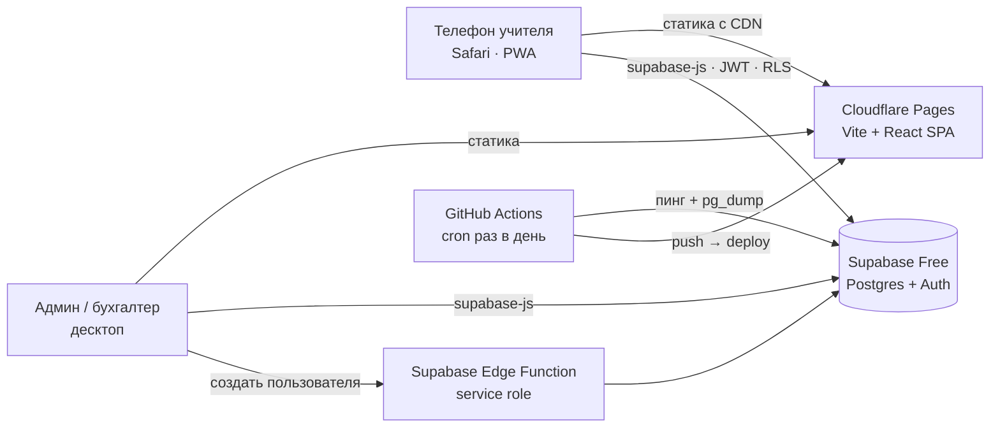
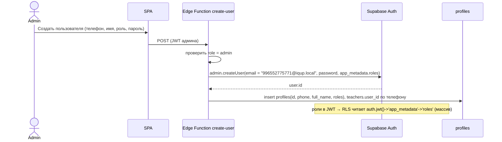

# IQUP Tracker — архитектура

Ограничения, из которых исходим: **ноль сом в месяц на инфраструктуру и ничего не засыпает**, один учебный центр (10 учителей, ~100 учеников, ~2 500 занятий в год), учитель работает с телефона (Safari, PWA), проект пишется агентами (Claude Code) — стек должен быть мейнстримным и хорошо документированным.

Решение зафиксировано 08.10.2026 после проверки актуальных бесплатных тарифов (см. §2.1).

## 1. Решение в одной картинке



**Сервера нет вообще.** Приложение — статические файлы на CDN. Вся логика доступа — в Postgres (RLS), расчёты — в SQL-views и функциях, единственный серверный код — Edge Function «создать пользователя». Нечему засыпать и не во что упираться по таймаутам.

## 2. Стек и обоснование

| Слой | Выбор | Почему | Отвергнуто |
|---|---|---|---|
| Фронт | **Vite + React 19 + TypeScript (strict)**, SPA | Внутреннее приложение за логином: SSR/SEO не нужны. Один слой, нет границы сервер/клиент — проще для агентов. Кайрат знает React | Next.js — тянет за собой Vercel Hobby (некоммерческая лицензия) или OpenNext на Cloudflare с шероховатостями |
| Роутинг / данные | **TanStack Router + TanStack Query** | Типизированные маршруты, кэш запросов, оптимистичные обновления при отметке посещаемости | React Router — ок, но без типизации маршрутов |
| UI | **Tailwind v4 + shadcn/ui** (radix-primitives) + **Motion** (ex-Framer Motion) + lucide-react | Готовые доступные компоненты; Motion — декларативные spring-анимации и 3D через CSS transform без three.js | MUI/Ant — тяжёлые на мобильном; three.js — избыточно |
| Мобильный | **PWA** (`vite-plugin-pwa`: manifest, иконка, standalone) | Один экран «Сегодня» — нативное приложение избыточно, сторы стоят денег/времени | React Native — отдельный проект |
| БД + Auth | **Supabase Free**: Postgres 500 МБ, Auth, RLS, Edge Functions (500k вызовов/мес), 2 проекта (dev/prod) | Права доступа в БД, расчёты в SQL, GUI для админа БД. Пауза только после **7 дней без запросов** — снимается ежедневным пингом | Neon — scale-to-zero через 5 мин, отключить нельзя: учитель ловил бы холодный старт по 2–3 раза в день; Cloudflare D1 — SQLite без RLS, с сентября 2026 запросы падают при превышении дневного лимита |
| Auth | Supabase Auth email/password с синтетическим email `996XXXXXXXXX@iqup.local` | Логин по телефону без SMS-провайдера. Пользователей создаёт только админ через Edge Function (service role) — саморегистрации нет | Phone OTP — платные SMS |
| Авторизация | **RLS в Postgres**, роль в `app_metadata` JWT | Правила «учитель видит только своё» нельзя обойти с клиента | Проверки только в коде SPA — обходятся DevTools |
| Хостинг | **Cloudflare Pages**, домен `iqup-tracker.pages.dev` | Бесплатно, без лимитов на статику, без ограничений на коммерческое использование, HTTPS, деплой по push, превью на PR | Vercel Hobby — «только некоммерческое»; Render Free — засыпает через 15 мин; Koyeb — закрыл free tier в 2026; Fly.io — без free |
| Схема/миграции | **SQL-миграции Supabase CLI** + `supabase gen types` | Расчёты — SQL-views: проще проверять и объяснять бухгалтеру | Prisma/Drizzle — лишний слой над RLS |
| Тесты | **Vitest** для чистых функций расчёта; **Playwright** smoke на ключевые экраны (мобильный viewport, WebKit) | Расчёт — единственное место, где ошибка стоит денег и доверия. WebKit в Playwright ловит Safari-баги | — |
| CI / бэкапы | **GitHub Actions**: lint + typecheck + test на PR; cron раз в день — `select 1` в Supabase (пинг) + еженедельный `pg_dump` в зашифрованный артефакт | Supabase Free не делает бэкапы; пинг не даёт проекту уснуть на каникулах | — |
| Репозиторий | **GitHub** (аккаунт Кайрата) | Интеграция с Cloudflare Pages, Actions бесплатно для приватных реп | — |

### 2.1 Что проверено по бесплатным тарифам (октябрь 2026)

| Площадка | Засыпает? | Лимиты | Вердикт |
|---|---|---|---|
| Cloudflare Pages / Workers | нет | 100k запросов/день к Workers, статика без лимита | ✅ фронт |
| Supabase Free | пауза после 7 дней без запросов | 500 МБ, 2 проекта, 500k edge-вызовов | ✅ БД, с пингом |
| Vercel Hobby | нет (serverless) | 100k вызовов/мес, 10 с на функцию, **некоммерческое** | запасной |
| Neon Free | scale-to-zero через 5 мин, не отключается | 1 ГБ, 100 CU-ч/мес | ❌ холодные старты |
| Cloudflare D1 | нет | 5 ГБ, 5M чтений/день, при превышении запросы **падают** | ❌ нет RLS |
| Render Free | через 15 мин, старт ~1 мин | — | ❌ |
| Koyeb / Fly.io / Railway | free-тиров нет (2026) | — | ❌ |

### Известные риски

| Риск | Что делаем |
|---|---|
| Supabase уснёт на длинных каникулах | Ежедневный пинг из GitHub Actions; даже если уснёт — восстановление из дашборда за минуту, данные не теряются |
| Нет SLA, нет поддержки | После закрытия периода бухгалтер видит замороженные цифры; еженедельный pg_dump |
| 500 МБ БД | При текущем объёме хватит на 10+ лет; аудит-лог можно архивировать |
| Один админ знает пароли | Логины/ключи в менеджере паролей Каныкей + Кайрата |

## 3. UI и дизайн-система

Прототип: Claude Design канвас «IQ UP Tracker — экраны учителя» (Вход, Сегодня, Посещаемость, Мой месяц, Расчёт ЗП для бухгалтера). Решения оттуда — источник для `tailwind.config` и компонентов.

### Палитра (из Instagram @iqupkg)

| Токен | Значение | Роль |
|---|---|---|
| `brand` | `#F2C230` | главное действие, активный таб, карточка текущего занятия (текст на нём — `ink`) |
| `ink` | `#141414` | текст, кнопка «Провести», тёмные карточки |
| `paper` | `#FFFDF6` | фон экранов; карточки `#FFFFFF`, границы `#EDE7D3` |
| `ink-muted` | `#6B6B6B` | вторичный текст (контраст 4.5:1 на paper) |
| `teal` | `#1C8C9E` | время, ссылки, **заморозка** |
| `present` | `#1E9E5A` | «Был», проведено |
| `burned` | `#D64545` | «Не был / сгорел», долг, не подтверждено |
| `warn` | `#B86A00` | «пора оплачивать» |
| shadcn `muted` / `accent` | `#F5F2E8` / `#FFF8E1` | светлые поверхности примитивов shadcn (TabsList, hover в Select); не брендовые цвета текста |
| Dark mode | фон `#121212`, карточки `#1C1C1C`, тот же `brand` | учителя часто в тёмной теме; делаем после пилота |

Шрифты (Google Fonts, полная кириллица): **Unbounded** 500/700/800 — заголовки, суммы, время; **Manrope** 500–800 — интерфейс. Self-host через `@fontsource` — чтобы не зависеть от Google в Safari PWA.

### Принципы экранов учителя

- Главный сценарий — отметить 8 учеников за 20 секунд одной рукой. Один экран «Сегодня», текущее занятие — крупная карточка сверху, список учеников — строка + три кнопки-состояния («Был / Заморозка / Не был»), tap target ≥ 44 px, итог и кнопка «Провести занятие» прилипают внизу.
- Нижняя навигация: Сегодня / Группы / Мой месяц.
- Никаких выпадающих списков и модалок в сценарии отметки.
- Статусы различаются и цветом, и текстом/иконкой (не только цветом).

### Анимации — три 3D-акцента, остальное быстрое

| Где | Что | Как |
|---|---|---|
| «Сегодня» | колода занятий: текущее сверху, следующие — стопкой с перспективой; свайп переворачивает | `perspective` + `rotateX` + Motion `drag` |
| Отметка ученика | flip карточки в цвет статуса | `rotateY` 180°, spring 300 мс |
| «Мой месяц» | tilt карточки ЗП за пальцем, count-up суммы | `rotateX/Y` по pointer, Motion `animate` числа |
| Всё остальное | spring-переходы экранов, скелетоны, микро-отклик кнопок | только `transform` / `opacity`; `prefers-reduced-motion` отключает 3D |

### Safari / iOS — закладываем сразу

`100dvh` вместо `100vh`; `env(safe-area-inset-*)` для выреза и домашней полоски; 16 px в полях ввода (иначе Safari зумит); `-webkit-tap-highlight-color: transparent`; `overscroll-behavior: none` на фиксированных панелях; анимировать только `transform`/`opacity`, без `backdrop-filter` на больших областях; `apple-mobile-web-app-capable` + иконки 180/192/512; тест Playwright в WebKit и на реальном iPhone.

## 4. Структура проекта

```
iqup-tracker/
├── CLAUDE.md                 # правила для агентов
├── .mcp.json                 # MCP для Claude Code (см. §9)
├── docs/
├── supabase/
│   ├── migrations/           # SQL: таблицы, RLS, views, triggers, функции
│   ├── functions/create-user/ # Edge Function (Deno), service role
│   ├── seed.sql              # тарифы, тестовые группы по Excel Каныкей
│   └── config.toml
├── src/
│   ├── routes/               # TanStack Router: /login, /today, /lessons/$id, /my-month, /admin/*, /payroll/*
│   ├── features/
│   │   ├── lessons/          # «Сегодня», колода, подтверждение
│   │   ├── attendance/       # отметка, flip-карточки, лимит заморозки
│   │   ├── payroll/calc.ts   # чистая функция расчёта — тесты
│   │   ├── payments/balance.ts
│   │   ├── groups/ students/ subscriptions/ users/
│   ├── lib/supabase/         # client, types.gen.ts, auth helpers
│   ├── components/ui/        # shadcn
│   └── styles/               # tailwind, токены, шрифты
├── tests/                    # vitest + playwright (webkit)
├── public/                   # manifest, иконки
└── .github/workflows/        # ci.yml, keepalive-backup.yml
```

## 5. Аутентификация и роли



- Телефон нормализуется в `996XXXXXXXXX`; вводится как привык (`0552 775 771`).
- Пароль выдаёт админ, пользователь может сменить; сброс — через админа.
- Роли — массив в `app_metadata.roles` (`["admin","teacher"]` — Каныкей, З1; пользователь не может менять), дублируются в `profiles.roles`. RLS-хелперы: `current_roles()`, `is_admin()`, `is_accountant()`, `teaches_group(id)` (миграция `0001_core.sql`).
- Связывание — триггер `link_teacher_profile` (`0003`): новый профиль с ролью `teacher` получает строку `teachers` с тем же телефоном или создаёт её; Edge Function и `seed-users.ts` ведут себя одинаково. С `0004` то же срабатывает, когда роль `teacher` **добавляют** существующему профилю (`after update of roles`).
- `create-user` — единственная точка записи пользователей (экран А8 `/admin/users`), действия: `create` (по умолчанию), `reset_password`, `update_roles` (`profiles.roles` + `app_metadata.roles` через `auth.admin.updateUserById` — новая роль попадает в JWT при следующем обновлении токена), `update_rate` с `mode`: `new` — новая строка `teacher_rates` с `valid_from` (дата уже занята → 409), `fix` — исправление процента строки с этим `valid_from` на месте (опечатка в текущей ставке; нет строки → 404), `set_active` (`profiles.is_active` + бан в Auth). Админ не может снять с себя роль `admin` и отключить себя.
- `teacher_rates` — админ пишет полностью (`0005` вернул `for all` после `0004`): опечатку в текущем проценте исправляют в той же строке, иначе сегодняшние занятия посчитаются по ошибочному. История — в `audit_log`. Запрет правок строк, чья `valid_from` в закрытом периоде, — R3 (закрытие периода).
- Последний вход для А8 — `user_last_sign_in()` (security definer, только staff).
- Учитель (`teachers`) существует до создания логина: `full_name`, `phone`, `user_id` — nullable, связывается при создании пользователя (сид — `scripts/seed-users.ts`).

### Матрица доступа (RLS-политики)

| Таблица | Учитель | Админ | Бухгалтер |
|---|---|---|---|
| `profiles` | свой | CRUD | read |
| `students` | read (из своих групп) | CRUD | read |
| `groups`, `schedule_rules` | read (свои) | CRUD | read |
| `enrollments` | read (свои группы) | CRUD | read |
| `lessons` | read (свои); update `status → held`, `confirmed_at`, `comment` до закрытия периода; не в день занятия → `confirmed_late`; create доп. урока своей группы | CRUD (если не locked) | read |
| `attendance` | insert/update по своим занятиям до закрытия периода | CRUD (если не locked) | read |
| `tariffs`, `holidays` | read | CRUD | read |
| `teacher_rates` | read свой процент | CRUD | read |
| `subscriptions`, `payments` | read по своим ученикам (остаток и долг с суммами) | CRUD | read |
| `payroll_periods` | read | read | open/close |
| `payroll_adjustments` | read свои | CRUD (авансы) | CRUD |
| `audit_log` | — | read | read |

Запись в `audit_log` — триггером `AFTER INSERT OR UPDATE OR DELETE`. Экран А10 читает `v_audit_feed` (0014, `security_invoker`): та же RLS, плюс `kind` для фильтра (`late` — подтверждено не в день занятия; `retro` — отметка изменена вне «Провести», проведённое занятие отменено/удалено, ставка исправлена с уже наступившей даты; `payment` — абонементы/оплаты; `attendance` — проведено в срок; `other`) и отметки «Провести», свёрнутые в строку занятия (`marks`).

## 6. Ключевые вычисления — где живут

| Что | Где | Почему |
|---|---|---|
| Генерация занятий из расписания | SQL-функция `generate_lessons(group_id, until_date)` | Идемпотентна (unique `group_id + lesson_date + planned_start`), пропускает `holidays` |
| Горизонт занятий | RPC `ensure_lessons(until)` — все группы `forming`/`active`, 8 недель вперёд; вызывают А3 при открытии и дашборд (R1-6) | Без cron; `duration_min` — из тарифа на дату (как `enroll_student`) |
| Смена расписания | RPC `reschedule_group(group, valid_from, weekdays, time, until)` (0008) | Одна транзакция: старые правила `valid_to = valid_from − 1`, будущие `planned` не по новому расписанию удаляются, held/cancelled/доп./начавшиеся не трогаются |
| Отмена / доп. урок / архив | RPC `cancel_lesson` (center/teacher/all_frozen, только `planned`, черновые отметки удаляются), `create_extra_lesson` (одно восполнение на отменённое), `archive_group` (удаляет будущие `planned`, завершает активные зачисления: `finished`, `end_date` = сегодня; абонементы не трогает — 0009) | `attendance_guard` не даёт отметить посещаемость на `cancelled` |
| Статус «Не подтверждено» | Вычисляемый в view: `status = 'planned' AND lesson_date < current_date` | Без cron |
| Баланс ученика (уроки и деньги) | View `subscription_balances` | Из первичных данных |
| Списание / заморозка | Триггер на `attendance`: `consumes_credit`, проверка `freeze_limit` | Правило одно для всех |
| Расчёт ЗП | View `payroll_preview(month)` + TS `calcStudentLessonPay()` с тестами, сверяющими SQL и TS | SQL — отчёты; TS — экран учителя и юнит-тесты |
| Старая схема (сверка в пилоте) | View `payroll_legacy(month)`: Σ оплат месяца по группам учителя × процент | Объяснить расхождение |
| Закрытие периода | SQL-функция `close_period(month)`: снапшот `payroll_lines`, `is_locked = true` | Атомарно |

## 7. Экран «Сегодня» — выбор текущего занятия

```
now = Asia/Bishkek
lessons_today = занятия учителя на сегодня по planned_start
current = первое, где planned_start − 15 мин ≤ now ≤ planned_end + 30 мин
current есть → верх колоды; иначе — ближайшее следующее
held — зелёные; planned в прошлом — красные «Не подтверждено»
```

Все даты — `timestamptz`, отображение в `Asia/Bishkek` (UTC+6, без летнего времени).

### 7.1 Время и синхронизация в реальном времени

Два разных механизма — не путать:

```
┌─ 1. Локальные часы (без сервера) ──────────────────────────────┐
│  useNow(): tick каждые 30 с → store.now                        │
│  всё, что зависит от времени, — чистые функции от (data, now):  │
│  «ещё 36 мин», «Сейчас / Далее», порядок колоды, бейдж «Идёт»,  │
│  «Не подтверждено» (now > planned_end && status = planned)      │
│  → перерисовка без запроса в сеть                               │
└─────────────────────────────────────────────────────────────────┘
┌─ 2. Чужие изменения (сервер) ──────────────────────────────────┐
│  Supabase Realtime: подписка на lessons / attendance / trials   │
│  событие → queryClient.invalidateQueries(...) → TanStack Query  │
│  дотягивает свежие строки. Страховка: refetchOnWindowFocus,     │
│  refetchOnReconnect, refetchInterval 60 с пока вкладка видна    │
└─────────────────────────────────────────────────────────────────┘
```

Правила:

- **Источник времени — сервер.** При входе один RPC `select now()` → `offset = serverNow − Date.now()`; дальше `now = Date.now() + offset`. Так сбитые часы на телефоне не делают урок «не подтверждённым» раньше времени. `confirmed_at`, `created_at` ставит только БД (`default now()`), клиентское время в таблицы не пишется.
- **Фон и сон.** В iOS Safari / PWA таймеры в фоне замораживаются. На `visibilitychange → visible`, `focus`, `online` делаем немедленный tick + `invalidateQueries`. Так после разблокировки телефона экран актуален за один кадр, а не через 30 с.
- **Границы.** Переход 14:59 → 15:00 (урок закончился, но не проведён) и полночь (сменился «сегодня») — это просто смена результата чистой функции от `now`; ключ запроса содержит дату, поэтому в полночь список занятий перезапрашивается сам. Cron для статусов не нужен (см. §6).
- **Что реально нужно realtime.** Учителю — почти ничего: его экран живёт на локальных часах, чужие правки (админ отменил урок, записал пробного) приходят через подписку на его `teacher_id`. Админу и бухгалтеру — подписка на все `lessons`, `attendance`, `payments`, `trials`: виджеты «Не подтверждено», «Идёт», «Оплат сегодня» обновляются в момент, когда учитель нажал «Провести».
- **Лимиты.** Supabase Free: 200 одновременных realtime-соединений, 2 млн сообщений/мес. У IQ UP ~15 пользователей и сотни событий в день — запас на два порядка. Если Realtime недоступен (Wi-Fi центра режет WebSocket), работает polling-страховка 60 с — пользователь разницы не заметит.
- **Оффлайн.** «Провести» — мутация `confirm_lesson` без optimistic update (И27): лист остаётся на месте до ответа БД, переход на «Сегодня» — только после успеха, ошибка — тостом, черновик отметок остаётся. Без сети мутация на паузе (лист показывает «Ждём связь… отметки сохранены»), TanStack Query отправит её при `online`. Конфликт «двое отметили один урок» решает `confirmed_at` — первый выиграл, второй видит экран «уже проведено».

## 8. Окружения и деплой (обновлено 13.10)

| | dev | prod |
|---|---|---|
| Supabase | `iqup-dev` (`kvivodokeqeasclporys`, аккаунт Кайрата) | `iqup-tracker-prod` (`nkuxkdmjdnbzssbtoboc`, организация IQUP на `info.iqupkg@gmail.com`, Кайрат — Owner) |
| Cloudflare Pages | `iqup-tracker.pages.dev` (аккаунт Кайрата), ветка `main` | проект в аккаунте IQ UP, ветка **`prod`** |
| GitHub | `Saitama7/iqup-tracker` — один репо для обоих | |

- Фронт деплоит Cloudflare Pages по пушу в свою ветку. БД и Edge Function — workflow `.github/workflows/deploy-supabase.yml`: `main` → dev, `prod` → prod (`supabase db push` + `functions deploy create-user`, затем проверка local = remote). Секреты: `SUPABASE_ACCESS_TOKEN`, `SUPABASE_DB_PASSWORD_DEV/PROD`; vars: `SUPABASE_PROJECT_REF_DEV/PROD`.
- В `prod` мержим `main` вручную по готовности (`git checkout prod && git merge --ff-only main && git push`), не по каждому PR.
- Keepalive пингует оба проекта раз в день (`supabase-keepalive.yml`, секреты `SUPABASE_URL[_PROD]`, `SUPABASE_ANON_KEY[_PROD]`).
- Prod без демо-сида: `supabase/seed.sql` только локально; на prod — справочники (`supabase/seed-prod.sql`: тарифы, предметы, праздники) и реальные пользователи через `create-user`.

## 9. Инструменты агентной разработки (Claude Code)

`.mcp.json` проекта:

| MCP | Зачем |
|---|---|
| **21st.dev Magic** (`@21st-dev/magic`) | Генерация UI-компонентов по описанию в стиле проекта; есть free tier |
| **shadcn** (`shadcn@latest mcp`) | Добавление компонентов и блоков shadcn/ui |
| **Context7** | Актуальные доки Supabase, TanStack, Motion, Tailwind v4 |
| **Supabase MCP** | Миграции, типы, SQL прямо из агента |
| **Playwright MCP** | Скриншоты и проверка экранов в WebKit |

Скиллы: `frontend-design` (Anthropic) для вёрстки, собственный `CLAUDE.md` с инвариантами домена.

## 10. Закрытые и открытые вопросы

1. ~~Фактическое время занятия~~ — не делаем (анкета А4).
2. ~~Родительский доступ~~ — не нужен (Д5).
3. ~~Next.js vs SPA~~ — SPA на Cloudflare Pages (08.10).
4. Dark mode — после пилота.
5. Telegram-бот «вы не подтвердили занятие» — после MVP.
6. Импорт учеников из Excel Каныкей — после того как увидим файл (Е1).
