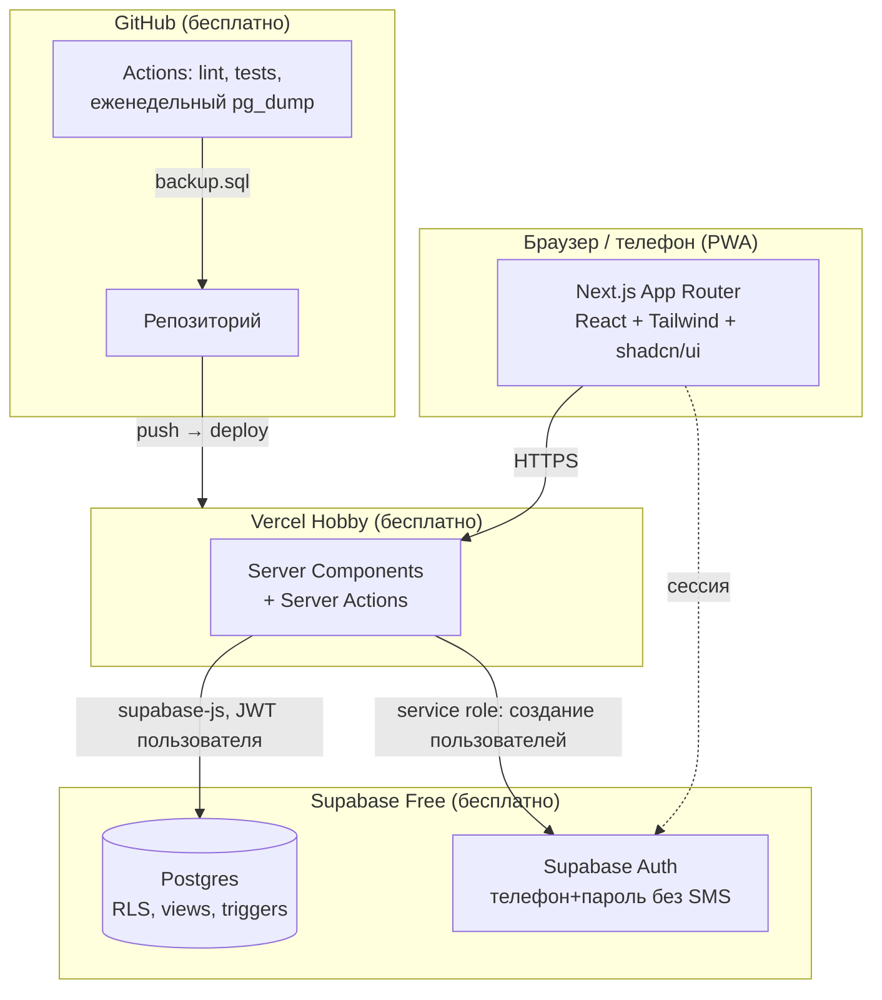
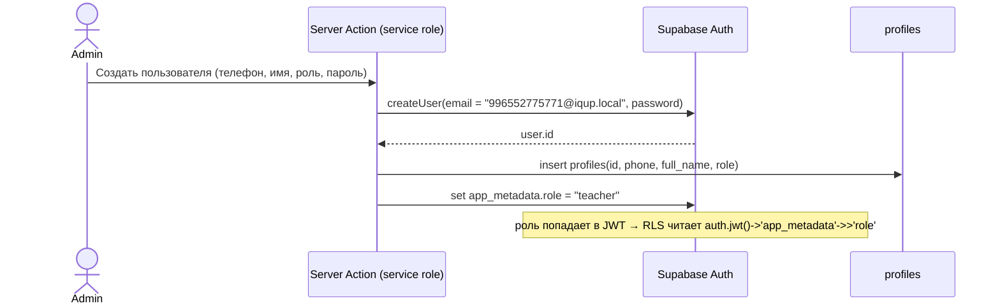

# IQUP Tracker — архитектура

Ограничения, из которых исходим: **ноль сом в месяц на инфраструктуру**, один учебный центр (~5–10 учителей, ~100–200 учеников, ~2 000 занятий в год), учитель работает с телефона, проект пишется агентами (Claude Code) — значит стек должен быть мейнстримным и хорошо документированным.

## 1. Решение в одной картинке



## 2. Стек и обоснование (ADR-кратко)

| Слой | Выбор | Почему | Отвергнуто |
|---|---|---|---|
| Фронт + бэк | **Next.js 15 (App Router), TypeScript** | Кайрат знает стек; один репозиторий; Server Actions убирают отдельный API-слой; Vercel деплоит из коробки | Отдельный NestJS — второй деплой, вторая авторизация, дольше |
| UI | **Tailwind + shadcn/ui** | Готовые доступные компоненты (таблицы, формы, диалоги), агенты хорошо с ними работают | MUI/Ant — тяжелее для мобильного |
| Мобильный | **PWA** (manifest + иконка на главный экран) | Учителю нужен один экран «сегодня» — нативное приложение избыточно, а сторы стоят денег/времени | React Native — отдельный проект |
| БД | **Supabase Free: Postgres 500 MB** | Postgres (views, triggers, функции для расчётов), Auth и Row Level Security в одном месте, бесплатно, GUI для админа БД | Neon — только БД, auth делать самим; Firebase — плохо для реляционной отчётности |
| Auth | **Supabase Auth, email/password** с синтетическим email `<phone>@iqup.local` | Логин по номеру телефона без SMS-провайдера (SMS платные). Пользователей создаёт только админ (server action с service role) — саморегистрации нет | Phone OTP — нужен Twilio и т.п. |
| Авторизация | **RLS в Postgres** + проверка роли в Server Actions | Правила «учитель видит только своё» живут в БД, их нельзя обойти с клиента | Только middleware — одна забытая проверка = утечка |
| Хостинг | **Vercel Hobby**, домен `iqup-tracker.vercel.app` | Бесплатно, HTTPS, деплой по push, превью на PR | Cloudflare Pages — запасной вариант, если Vercel посчитает использование коммерческим |
| Схема/миграции | **SQL-миграции Supabase CLI** + генерация TS-типов (`supabase gen types`) | Расчёты (баланс, ЗП) — это SQL-views: проще проверять и объяснять бухгалтеру | Prisma — лишний слой над RLS |
| Тесты | **Vitest** для чистых функций расчёта ЗП/баланса; **Playwright** smoke на ключевые экраны | Расчёт ЗП — единственное место, где ошибка стоит денег и доверия | — |
| Бэкапы | **GitHub Actions cron** раз в неделю: `pg_dump` → зашифрованный артефакт | Supabase Free не делает бэкапы. Для системы расчёта зарплат это обязательно | — |
| Репозиторий | **GitHub** (аккаунт Кайрата) | Vercel-интеграция, Actions бесплатно для приватных реп | GitLab — тоже ок, если захочется |

### Известные риски бесплатных тиров

| Риск | Эффект | Что делаем |
|---|---|---|
| Supabase Free **ставит проект на паузу после 7 дней без запросов** | Летом (каникулы) система «уснёт», первый вход займёт минуту-две | Еженедельный бэкап-джоб в GitHub Actions заодно делает запрос к БД — проект не засыпает |
| Vercel Hobby — лицензия «некоммерческое личное использование» | Формально внутренний инструмент бизнеса — серая зона | Трафик ничтожный, но держим Cloudflare Pages как план Б (Next.js через OpenNext) |
| Нет SLA, нет поддержки | Падение в день зарплаты | Экспорт расчёта в Excel после закрытия периода — бухгалтер хранит копию локально |
| Один админ знает пароли | Потеря доступа | Логины/ключи в менеджере паролей Каныкей + Кайрата |

## 3. Структура проекта

```
iqup-tracker/
├── CLAUDE.md                 # правила для агентов: домен, стек, команды
├── docs/                     # эти документы
├── supabase/
│   ├── migrations/           # SQL: таблицы, RLS, views, triggers
│   ├── seed.sql              # тарифы, тестовые группы
│   └── config.toml
├── src/
│   ├── app/
│   │   ├── (auth)/login/
│   │   ├── (teacher)/today/            # экран «Сегодня»
│   │   ├── (teacher)/lessons/[id]/     # посещаемость
│   │   ├── (teacher)/my-month/
│   │   ├── (admin)/groups/ students/ schedule/ tariffs/ users/
│   │   ├── (accounting)/payroll/ payments/ periods/
│   │   └── api/                        # только для экспорта файлов
│   ├── features/             # по доменам: lessons, attendance, payroll, payments, groups
│   │   └── payroll/calc.ts   # чистые функции расчёта — покрыты тестами
│   ├── lib/supabase/         # клиенты (browser / server / service-role)
│   ├── lib/auth/             # роль из сессии, guard-функции
│   └── components/ui/        # shadcn
├── tests/                    # vitest + playwright
└── .github/workflows/        # ci.yml, backup.yml
```

## 4. Аутентификация и роли



- Телефон нормализуется в `996XXXXXXXXX`; пользователь вводит как привык (`0552 775 771`).
- Пароль выдаёт админ, пользователь может сменить в профиле. Сброс — через админа (без SMS/почты).
- Роль хранится в `app_metadata` (пользователь сам её менять не может) и дублируется в `profiles` для джойнов.

### Матрица доступа (реализуется RLS-политиками)

| Таблица | Учитель | Админ | Бухгалтер |
|---|---|---|---|
| `profiles` | свой | CRUD | read |
| `students` | read (только из своих групп) | CRUD | read |
| `groups`, `schedule_rules` | read (свои) | CRUD | read |
| `enrollments` | read (свои группы) | CRUD | read |
| `lessons` | read (свои); update `status → held`, `confirmed_at`, `comment` — только в день занятия и если `is_locked = false` | CRUD (если не locked) | read |
| `attendance` | insert/update по своим занятиям в день занятия | CRUD (если не locked) | read |
| `tariffs`, `pay_rates` | read своих ставок | CRUD | read |
| `payments` | — | CRUD | CRUD |
| `payroll_periods` | read | read | open/close |
| `payroll_adjustments` | read свои | CRUD | CRUD |
| `audit_log` | — | read | read |

Запись в `audit_log` делается триггером `AFTER INSERT OR UPDATE OR DELETE` на ключевых таблицах — приложение не может «забыть» залогировать.

## 5. Ключевые вычисления — где живут

| Что | Где | Почему |
|---|---|---|
| Генерация занятий из расписания | SQL-функция `generate_lessons(group_id, until_date)` | Идемпотентна (unique на `group_id + lesson_date + planned_start`), учитывает таблицу `holidays` |
| Статус `unconfirmed` | Вычисляемый: `status = 'planned' AND lesson_date < current_date` в view `lessons_view` | Не нужен cron (на Vercel Hobby только 1 cron/день) |
| Баланс ученика | View `enrollment_balances`: Σ purchased − Σ consumed | Всегда из первичных данных, нельзя подправить руками |
| Списание `consumes_credit` | Триггер на `attendance` по правилу из §5 доменной модели + `tariff.free_excused_misses` | Правило одно, применяется одинаково для всех |
| Расчёт ЗП | View `payroll_preview(month)` + чистая TS-функция `calcLessonPay()` с тестами (та же логика, проверка один-в-один) | SQL — для отчётов; TS — для юнит-тестов и показа учителю |
| Закрытие периода | SQL-функция `close_period(month)`: снапшот `payroll_lines`, `is_locked = true` на занятиях месяца | Атомарно, одной транзакцией |
| Экспорт Excel | Route handler + `exceljs` | Бухгалтер хранит копию |

## 6. Экран «Сегодня» учителя — логика выбора занятия

```
now = текущее время (Asia/Bishkek)
lessons_today = занятия учителя на сегодня, отсортированы по planned_start
current = первое занятие, где planned_start − 15 мин ≤ now ≤ planned_end + 30 мин
если current есть → показать его карточкой сверху с кнопкой «Открыть»
иначе → показать ближайшее следующее, остальные списком
занятия со статусом held — зелёные, planned в прошлом — красные «Не подтверждено»
```

Все даты/время в БД — `timestamptz`, отображение — в `Asia/Bishkek` (UTC+6, без перехода на летнее время).

## 7. Нефункциональные требования

- **Мобильный first**: экраны учителя — на ширину 360 px, крупные кнопки «Присутствует/Отсутствует», отметка одним тапом.
- **Офлайн**: не поддерживаем в MVP (в центре есть Wi-Fi). Если отметка не ушла — показываем ошибку, не теряем состояние формы.
- **Язык интерфейса**: русский. Кыргызский — позже, если потребуется.
- **Производительность**: объём данных мал; индексы на `lessons(teacher_id, lesson_date)`, `attendance(lesson_id)`, `payments(enrollment_id)`.
- **Безопасность**: service-role ключ только в server-side env; RLS включён на всех таблицах; никаких публичных anon-запросов кроме логина.

## 8. Деплой и окружения

| Окружение | Где | Зачем |
|---|---|---|
| local | `supabase start` (Docker) + `next dev` | Разработка, миграции |
| preview | Vercel preview на PR + отдельный Supabase branch или тот же dev-проект | Показать Каныкей фичу до релиза |
| production | Vercel production + Supabase prod-проект | Бесплатный тир Supabase даёт 2 проекта — dev и prod |

## 9. Открытые архитектурные вопросы

1. Фактическое время (`actual_start/end`) — делать ли кнопки «Начать/Закончить» в MVP (зависит от ответа Каныкей про природу споров).
2. Нужен ли родительский доступ (посмотреть баланс ребёнка) — если да, это четвёртая роль и read-only экран; в MVP нет.
3. Уведомления (Telegram-бот «вы не подтвердили занятие») — бесплатно реализуемо, но после MVP.
