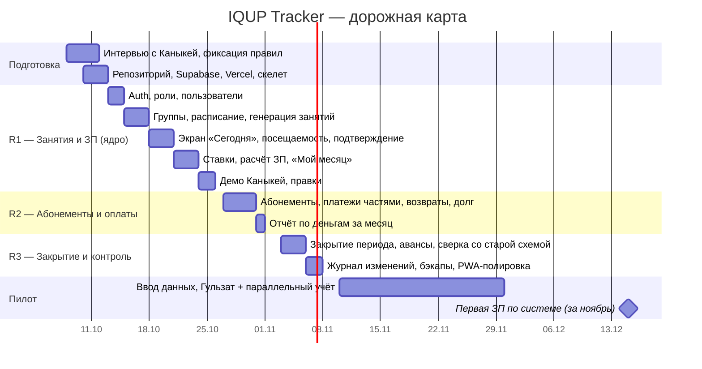

# IQUP Tracker — план проекта

## 1. Что строим и зачем (резюме для Каныкей)

Внутренняя система учёта для IQ UP, которая убирает споры о зарплате: учитель отмечает занятие в момент проведения, система считает часы и сумму, бухгалтер закрывает месяц, все видят одни и те же цифры. Дополнительно — учёт оплат и балансов учеников, чтобы знать, кто сколько занятий оплатил и у кого долг.

Система бесплатна в эксплуатации (бесплатный хостинг и БД), разрабатывается Кайратом с помощью AI-агентов.

## 2. Ценность и метрики успеха

| Метрика | Сейчас | Цель через 2 месяца после запуска |
|---|---|---|
| Споров о ЗП в день зарплаты | каждый месяц | 0 — любой вопрос закрывается показом истории занятия |
| Время подготовки расчёта ЗП | часы ручного пересчёта | < 15 минут: открыть отчёт, проверить, закрыть период, экспорт |
| Доля занятий, подтверждённых в день проведения | — | ≥ 95 % |
| Ученики с неизвестным балансом/долгом | «примерно помним» | 0 — баланс виден по каждому |
| Стоимость инфраструктуры | 0 | 0 |

## 3. Границы (scope)

**Входит (полный учёт):**
- Роли учитель / админ / бухгалтер, вход по телефону и паролю.
- Группы, расписание, автогенерация занятий, праздники.
- Ученики, зачисления (в т. ч. с середины курса), скидки.
- Посещаемость, подтверждение занятия с фиксацией времени.
- Тарифы, оплаты учеников, баланс в занятиях, долги, правило бесплатных пропусков.
- Ставки учителей (несколько типов), расчёт ЗП, корректировки, закрытие периода, экспорт в Excel.
- Полный журнал изменений.

**Не входит:** онлайн-оплата, оценки/ДЗ, SMS, родительский кабинет, налоги, мультицентр (SaaS). Всё это — кандидаты на «после».

## 4. Этапы

### R1 — ядро (2 недели, 13–24 октября)
Результат: учитель отмечает занятия с телефона (присутствовал / заморозка / сгорел), админ создаёт группы и расписание, у учителя задан процент, оба видят предварительную ЗП по формуле «ученико-урок × цена урока × %». Уже это закрывает главную боль. Критерий готовности: Гульзат неделю отмечает занятия в системе параллельно с Excel — расхождений в количестве ученико-уроков нет.

### R2 — абонементы и оплаты (1 неделя, 27–31 октября)
Результат: админ создаёт абонементы и записывает платежи (частями, наличные / Mbank), система показывает остаток уроков, долг в деньгах, лимит заморозки, возвраты; учитель видит долги своих учеников с суммами. Отчёт «деньги за месяц по группам и учителям».

### R3 — закрытие периода (1 неделя, 3–7 ноября)
Результат: бухгалтер закрывает месяц, видит рядом сумму по старой схеме (45 % от оплат) для сверки, авансы вычитаются, журнал изменений доступен. Бэкапы работают. Экспорт в Excel — не нужен (анкета Е5).

### Пилот (10 ноября — 15 декабря)
Гульзат первая, затем все учителя отмечают занятия в системе, Excel ведётся параллельно. **15 декабря** — первая зарплата за ноябрь, посчитанная системой и сверенная со старым способом. После этого Excel отключается.

## 5. Роли в проекте

| Кто | Роль |
|---|---|
| Каныкей | Владелец продукта: отвечает на вопросы о правилах, принимает демо, вводит начальные данные (группы, ученики, учителя), обучает команду |
| Кайрат | Технический руководитель и стратег: решения по продукту и архитектуре, ревью, деплой |
| Claude (Code / Cowork) | Проектирование, кодирование, тесты, документация |
| Алишка (брат Каныкей, второй администратор) | Принимает оплаты, вводит абонементы и платежи |
| Бухгалтер IQ UP | Проверяет расчёт в пилоте, закрывает период |
| Гульзат (учитель-пилот) | Первой пользуется с R1, даёт обратную связь по экрану «Сегодня» |

## 6. Стоимость

| Статья | Сумма |
|---|---|
| Хостинг (Vercel Hobby) | 0 |
| БД + Auth (Supabase Free) | 0 |
| Домен (`*.vercel.app`) | 0 |
| CI/бэкапы (GitHub Actions) | 0 |
| Разработка | время Кайрата (~4 недели по вечерам) + подписка Claude, которая уже есть |

## 7. Риски

| Риск | Вероятность | Что делаем |
|---|---|---|
| Учителя не примут новую схему (начисление по урокам вместо 45 % от оплат месяца): в первый месяц суммы могут быть меньше привычных | средняя | Экран сверки «старая схема / новая схема» в пилоте; Каныкей объясняет заранее, что разница — перенос, а не потеря |
| Учителя не отмечают вовремя | высокая в первые недели | Статус «Не подтверждено» виден всем; в ЗП не попадает → мотивация; позже — напоминание в Telegram |
| Каныкей не успевает ввести начальные данные | средняя | Импорт из Excel/Google Sheets шаблона; Кайрат помогает один раз |
| Бесплатный тир ограничит (пауза Supabase, лимиты Vercel) | низкая | См. риски в архитектуре; план Б — Cloudflare Pages / Neon |
| Scope creep («а давайте ещё оценки») | высокая | Всё новое — в список «после пилота»; до 1 декабря меняется только то, что мешает посчитать ЗП |

## 8. Что дальше (после пилота) — не обещаем, записываем

- Telegram-бот: напоминание учителю, отчёт родителю о балансе.
- Родительский read-only доступ.
- Импорт/экспорт учеников.
- Кыргызский язык интерфейса.
- Если система приживётся — другие учебные центры Бишкека имеют ту же боль. Архитектура не мешает добавить `center_id` и превратить в micro-SaaS, но в MVP этого сознательно нет.

## 9. Ближайшие шаги

1. ~~Анкета Каныкей~~ — заполнена 08.10, решения в [05-decisions.md](05-decisions.md).
2. ~~5 уточнений~~ — закрыты 08.10. Попросить у Каныкей **файл Excel с учётом за сентябрь** (анкета Е1) — по нему сделаем тестовые данные и сверку.
3. ~~Стек и UI~~ — зафиксированы 08.10: Vite SPA + Cloudflare Pages + Supabase; дизайн-прототип в Claude Design.
4. Создать репозиторий на GitHub, проекты Supabase (dev/prod) и Cloudflare Pages; `.mcp.json` с 21st.dev Magic, shadcn, Context7, Supabase, Playwright.
5. Старт R1 (13 октября).
